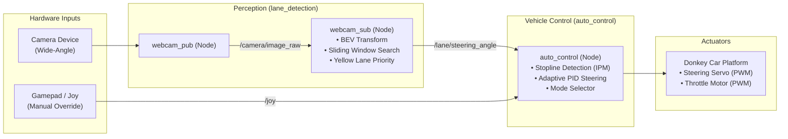
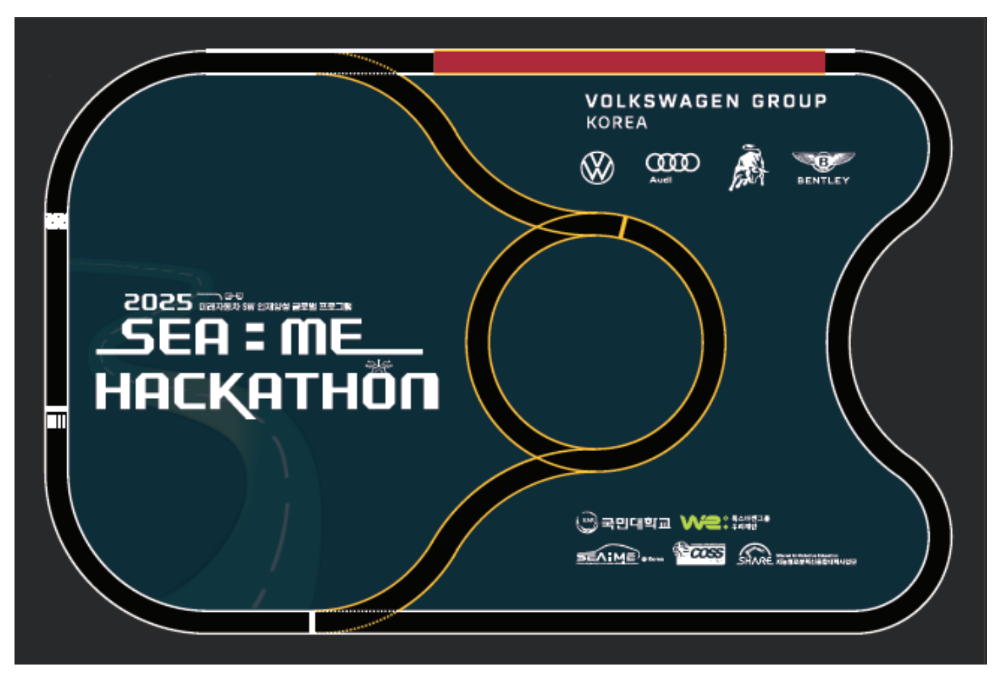
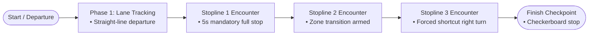

# SEA:ME Hackathon 2025: Autonomous Mobile Robot System

A real-time vision-based autonomous driving and control system developed for the 2025 SEA:ME Hackathon. The platform integrates the Donkey Car RC chassis with ROS 2 (Robot Operating System) to perform lane tracking, stopline recognition, adaptive steering control, and on-board telemetry.

---

## Overview

This repository contains the full software architecture deployed during the competition. The system utilizes a monocular camera and embedded sensor suite to navigate track courses autonomously, respond to visual landmarks (stoplines, checkerboard patterns), and monitor power subsystem health in real time.

### Core Capabilities

- **Real-Time Perception**: Monocular camera streaming with Bird's Eye View (BEV) perspective transform, sliding window lane polynomial fitting, and priority-weighted yellow lane filtering.
- **Adaptive Vehicle Control**: Closed-loop PID steering controller compensating for battery discharge, state-machine-driven stop-and-go maneuvers, and manual override fail-safes.
- **Embedded Telemetry**: Asynchronous I2C driver querying the INA219 sensor and visualizing live voltage, current, and state of charge (SoC) on an SSD1306 OLED display.

---

## System Architecture



---

## Repository Structure

```text
2025-seame-hackathon/
├── README.md
├── .gitignore
├── ros2_ws/                                  # ROS 2 Workspace
│   └── src/
│       ├── auto_control/                     # C++ Vehicle Control Package
│       │   ├── CMakeLists.txt
│       │   ├── package.xml
│       │   ├── scripts/
│       │   │   └── main.py                   # Master controller & joystick supervisor
│       │   ├── src/
│       │   │   ├── auto.cpp                  # Primary competition autonomous node
│       │   │   └── stopline_detect.cpp       # Stopline & checkerboard detection
│       │   └── variants/                     # Tuning & experimental control nodes
│       │       ├── auto_adaptive_pid.cpp     # Voltage-compensated PID controller
│       │       ├── auto_shortcut.cpp         # Segment-based forced steering
│       │       └── auto_yellow_priority.cpp  # Yellow boundary-weighted control
│       └── lane_detection/                   # Python Perception Package
│           ├── package.xml
│           ├── setup.py
│           └── lane_detection/
│               ├── __init__.py
│               ├── webcam_pub.py             # ROS 2 video publisher
│               ├── webcam_sub.py             # Sliding window lane detector
│               └── auto_manual_switch.py     # Operational mode switcher
├── docs/                                     # Documentation Assets
│   └── images/
│       └── track_layout.png                  # Competition track map and course layout
├── donkeycar/                                # Donkey Car Platform Stack
│   └── mycar/
│       ├── calibrate.py                      # Steering/throttle PWM calibration
│       ├── config.py                         # Framework configuration
│       ├── manage.py                         # Donkey Car execution entry point
│       └── myconfig.py                       # Vehicle-specific parameter overrides
└── hardware/                                 # On-board Sensors & Diagnostics
    ├── battery_oled_monitor.py               # INA219 & SSD1306 live telemetry daemon
    └── display_off.py                        # Display power-down utility
```

---

## Track Specifications & Mission Scenarios



The competition circuit presents challenging real-world autonomous racing scenarios involving multi-color markings, metric distinction between road obstacles, sequential stoplines, branching shortcuts, and a checkerboard finish line.

### Track Marking Geometry & Feature Classification

To eliminate false positives between road markings, the perception pipeline converts pixel dimensions to physical metric units using Inverse Perspective Mapping (IPM) calibration (`PIXELS_PER_CM_WIDTH`):

| Marking Type | Dimensions (cm) | Optical Characteristics | Autonomous Behavior |
| :--- | :--- | :--- | :--- |
| **Stopline** | 35.0 cm (W) x 6.0 cm (T) | Continuous high-luminance white (`L > 200`) | Triggers state machine pause & branch transitions |
| **Crosswalk** | 17.8 cm (W) x 3.6 cm (T) | Periodic segmented white stripes | Filtered out by aspect ratio & width thresholding |
| **Center / Priority Lane** | Variable length | Continuous yellow stripe (`HLS/HSV`) | Prioritized over white boundaries in curved zones |
| **Outer Boundary Lane** | Variable length | Continuous white stripe | Standard sliding-window polynomial guidance |
| **Finish Line** | Full lane width | High-contrast black/white checkerboard | Verified by `detect_checkerboard()` to stop the vehicle |

### Sequential Race Scenarios & State Machine



1. **Phase 1: Startup & Lane Tracking**  
   The vehicle tracks both white and yellow boundaries using adaptive sliding windows. During the first 5 seconds, right-steering bias under low-confidence conditions is suppressed to ensure stable straight-line departure.

2. **Phase 2: Mandatory Stop & Re-launch (Stopline 1)**  
   Upon detecting the primary 35 cm stopline in the lower 40% ROI, throttle is clamped to zero for exactly 5.0 seconds. After the countdown, the vehicle automatically resumes motion and activates a 10-second detection lockout to prevent double-stopping on the same line.

3. **Phase 3: Transition Arming (Stopline 2)**  
   Passing the second stopline arms the navigation state machine for upcoming directional branch decisions.

4. **Phase 4: Forced Shortcut Maneuver (Stopline 3)**  
   Detecting the third stopline triggers a calibrated forced right-turn steering routine (`지름길 강제 조향`). White lane detection is temporarily masked to avoid conflicting steering inputs and ensure clean entry into the shortcut course.

5. **Phase 5: Finish Line Checkpoint**  
   The finish line is actively monitored by `detect_checkerboard()`, which validates square contour geometries and lightness variances across consecutive tiles. Upon threshold confirmation, motor throttle is immediately cut to finish the trial safely.

---

## Technical Implementations

### 1. Vision & Perception (`lane_detection`)
- **Inverse Perspective Mapping (IPM)**: Projects the forward-facing camera feed into a top-down Bird's Eye View (BEV) plane, mitigating perspective distortions.
- **Sliding Window Search**: Divides the binary thresholded image into vertical slices to track lane centerlines across curved trajectories.
- **Dynamic Yellow Masking**: Enhances robustness against varied lighting and reflection by prioritizing yellow center/boundary lane markers.

### 2. Vehicle Control & State Machine (`auto_control`)
- **PID Steering**: Computes real-time angular deviations from lane centerlines and applies closed-loop PID correction to maintain path alignment.
- **Stopline Event Handling**: Detects transverse line markings and checkerboard patterns to execute timed deceleration, pause, and scheduled re-acceleration.
- **Supervisor Node (`main.py`)**: Subscribes to joystick events (`joy_callback`) to support immediate manual takeover via button mapping.

### 3. Hardware Monitoring (`hardware`)
- **INA219 Power Sensor**: Samples bus voltage, shunt voltage, and current draw at 1 Hz intervals over I2C.
- **SSD1306 Display**: Renders real-time voltage, calculated battery percentage (`MAX_V = 16.8V`, `MIN_V = 12.0V`), and elapsed runtime.
- **Fault-Tolerant Loop**: Traps I2C communication exceptions to ensure sensor dropouts do not interrupt mission-critical processes.

---

## Build and Execution

### Prerequisites
- Ubuntu 20.04 / 22.04 LTS
- ROS 2 (Foxy / Humble)
- OpenCV 4.x
- Python 3.8+ (`luma.oled`, `adafruit-circuitpython-ina219`, `adafruit-blinka`)

### 1. Build ROS 2 Packages
```bash
cd ros2_ws
colcon build --symlink-install
source install/setup.bash
```

### 2. Launch Autonomous Driving Nodes
```bash
# Terminal 1: Camera Publisher
ros2 run lane_detection webcam_pub

# Terminal 2: Lane Detection Processor
ros2 run lane_detection webcam_sub

# Terminal 3: Main Vehicle Controller
ros2 run auto_control auto
```

### 3. Run Hardware Telemetry
```bash
python3 hardware/battery_oled_monitor.py
```

---

## Hardware Specifications

- **Chassis**: 1:16 Scale RC Platform (Donkey Car derivative)
- **On-board Computer**: Raspberry Pi 4 Model B (4GB / 8GB)
- **Camera**: Wide-Angle USB / CSI Monocular Camera
- **Power Sensor**: INA219 High-Side DC Current & Voltage Sensor (I2C: `0x40`)
- **Display**: SSD1306 0.96-inch 128x64 Monochromatic OLED (I2C: `0x3C`)

---

## Contributors

- [Yoonjin Cho](https://github.com/gerrard088)
- [Daeho Won](https://github.com/1daymore)
- [Jeongyun Choi](https://github.com/choijeongyun12)
